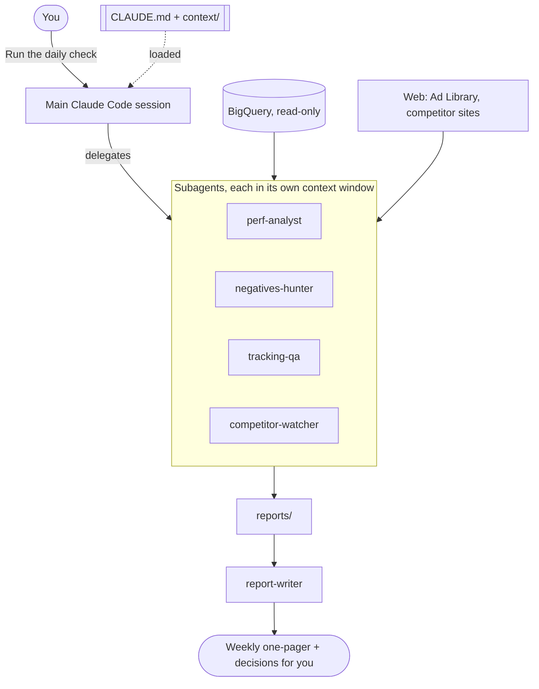

# Performance Marketing Subagents for Claude Code

**A team of AI analysts that reads your ad data in BigQuery every morning, flags what actually matters, and proposes fixes. You approve every change.**

Built with [Claude Code subagents](https://code.claude.com/docs/en/sub-agents). It runs in the Claude desktop app (Code tab) or the terminal, and reads your data through a BigQuery connector. Read-only by design.

---

## Why

Most performance marketers start the day the same way: open Google Ads, open Meta, open GA4, export, compare, squint. This repo turns that routine into five specialized agents:

| Agent | What it does | Output |
|---|---|---|
| **perf-analyst** | Daily pacing across channels: spend, CPC, CPA by conversion level, anomalies vs a 14-day baseline | `reports/<date>-pacing.md` + RED/AMBER/GREEN summary |
| **negatives-hunter** | Finds wasted spend in search terms (students, jobs, free, wrong product, wrong tier) | Google Ads Editor-ready CSV of negatives |
| **tracking-qa** | Checks every conversion action is still firing, and compares ad platforms vs analytics vs backend | OK / DRIFT / BROKEN per action |
| **competitor-watcher** | Tracks competitors' ads, pricing and messaging, and reports only what changed | `reports/<date>-competitors.md` |
| **report-writer** | Turns everything into a one-page weekly summary, with the decisions you need to make | `reports/<week>-weekly.md` |

Plus a **`/setup-project`** skill that interviews you, discovers your BigQuery tables, and configures everything.

---

## How it works

Each subagent runs in its **own context window** and returns only a short summary, so your main session stays clean. Context is split into three layers:

| Layer | Where | Loaded |
|---|---|---|
| Always-on rules | `CLAUDE.md` (< 100 lines) | Every session and every agent |
| Reference knowledge | `context/*.md` (data dictionary, KPIs, accounts, competitors, decisions) | Only by the agents that need it |
| Learned patterns | `.claude/agent-memory/` (`memory: project`) | When that agent runs; only owner-confirmed learnings |

More in [docs/architecture.md](docs/architecture.md).

---

## Quickstart (about 15 minutes)

**You need:**
- A Claude plan that includes Claude Code (Pro, Max, Team or Enterprise)
- A BigQuery connector added in [claude.ai → Connectors](https://claude.ai/customize/connectors)
- Your ad data in BigQuery. The Google Ads native [BigQuery Data Transfer](https://cloud.google.com/bigquery/docs/google-ads-transfer) works out of the box; other channels can use any loader.

**Steps:**
1. **Get the repo.** Clone it, or download the ZIP and unzip it.
2. **Open it in Claude.** Desktop app → **Code** tab → environment **Local** → **Open folder…** → this folder. In a terminal, run `claude` inside the folder instead.
3. **Set the permission mode to Manual**, so you see every action at first.
4. **Run `/setup-project`.** It asks about your business, finds your tables, maps your conversion actions, fills the placeholders, tests the main query, and blocks the connector's write tool.
5. **First run:** `Use the perf-analyst subagent to run the daily check.`

Step-by-step with screenshots-level detail: [docs/setup-desktop.md](docs/setup-desktop.md).

> **Important:** once `context/` contains your real business data, keep your copy of the repo **private**. `reports/` and agent memory are already gitignored.

---

## Safety

- **Read-only.** Agents query with the connector's read-only SQL tool, and the write tool is denied in `.claude/settings.json`.
- **Human in the loop.** Agents never touch ad accounts. Negatives come out as a CSV *you* import.
- **No guessing.** If data is missing, agents say so instead of estimating.
- Details: [docs/safety.md](docs/safety.md)

## Run it on a schedule

Local scheduled task (your Mac/PC) or cloud scheduled task (always on). See [docs/scheduling.md](docs/scheduling.md).

## Customize

Add a channel, tune thresholds, or create your own agent: [docs/customize.md](docs/customize.md).

---

## Gotchas this repo already handles

Lessons from running these agents on a real multi-channel account:

1. **Google Ads `metrics_conversions` lies (sort of).** In the BasicStats tables it sums *all primary conversion actions*, so sign-ups, micro-events and purchases are mixed together. CPA built on it can be off by an order of magnitude. The agents use `ads_CampaignConversionStats_*` filtered by action.
2. **Conversion lag.** The last 2–3 days of ad-platform conversions are incomplete and get restated, so naive "yesterday vs last week" alerts fire every morning. The agents use lag-safe windows.
3. **GA4 raw export never backfills**, but the Ads UI does. Comparing them day by day creates fake discrepancies.
4. **Some BigQuery connectors return an empty dataset list** even when they work. `/setup-project` falls back to `INFORMATION_SCHEMA`.
5. **Tracking breaks silently** during site migrations. `tracking-qa` flags any conversion action that drops to zero across all campaigns.

---

## Roadmap

- [ ] Budget pacing vs monthly target, with an end-of-month forecast
- [ ] Creative fatigue agent for Meta (frequency × CTR decay)
- [ ] Lightweight MMM / channel-incrementality agent
- [ ] Delivery to Slack or email
- [ ] LinkedIn Ads and TikTok Ads templates

Ideas and PRs welcome.

## Contributing

1. Fork the repo and create a branch.
2. Keep agents generic: no company-specific data, IDs or names.
3. Test with your own data, then open a PR describing what you changed and why.

## License

[MIT](LICENSE)

---

Made by **Victor_Hernandez** · [LinkedIn](https://www.linkedin.com/in/victorhb/)
If this saves you time, a star helps others find it.
